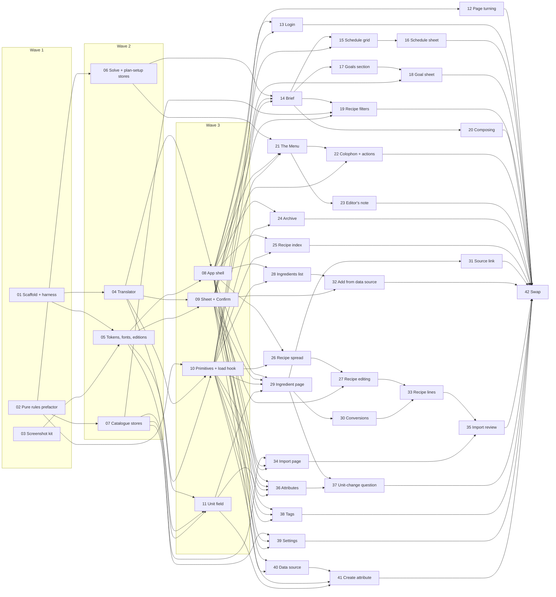

# React frontend in the D2 look: tickets

Tickets for [the spec](../spec.md), one file per ticket, numbered in dependency order (blockers first). Each ticket is self-contained for an agent in a fresh context: it names the spec sections and story numbers it covers and the Vue files that are its parity checklist. **Read this README's Conventions before starting any ticket.**

Every ticket keeps `npm run lint`, `npm run typecheck` and `npm test` green in `web/`; the Vue app stays the served app (and the e2e flow keeps passing) until ticket 42.

## Tickets

| # | Ticket | Blocked by | Wave |
|---|---|---|---|
| 01 | [React app side by side, with its app test harness](01-react-app-side-by-side.md) | none | 1 |
| 02 | [Prefactor: separate the pure rules from the Vue hooks](02-separate-pure-rules-from-vue.md) | none | 1 |
| 03 | [Screenshot kit and sample data](03-screenshot-kit-and-sample-data.md) | none | 1 |
| 04 | [Translator reading the existing English messages](04-translator.md) | 01 | 2 |
| 05 | [Paper and ink: tokens, fonts, editions and the specimen](05-paper-and-ink-design-foundation.md) | 01, 03 | 2 |
| 06 | [Framework-neutral stores for the solve and the plan setup](06-plan-stores.md) | 02 | 2 |
| 07 | [Framework-neutral stores for units, preferences, questions and hand-overs](07-catalogue-stores.md) | 02 | 2 |
| 08 | [App shell: masthead, Contents, page registry, routes and the session](08-app-shell.md) | 04, 05 | 3 |
| 09 | [Sheet and Confirm](09-sheet-and-confirm.md) | 04, 05 | 3 |
| 10 | [Form and display primitives, and the load hook](10-form-and-display-primitives.md) | 02, 04, 05 | 3 |
| 11 | [Unit field (combobox)](11-unit-field.md) | 04, 05, 07 | 3 |
| 12 | [Turning pages: swipes, turn links, folio and the skip link](12-page-turning.md) | 08 | 4 |
| 13 | [Login page in the D2 look](13-login-page.md) | 08, 10 | 4 |
| 14 | [This week's brief: cover, standfirst, today, time allowed and Compose](14-this-weeks-brief.md) | 06, 08, 10 | 4 |
| 15 | [The schedule: grid of place settings and "at least" per day](15-schedule-grid.md) | 09, 14 | 5 |
| 16 | [The schedule sheet: start date, days and meal names](16-schedule-sheet.md) | 15 | 6 |
| 17 | [The goals section of the brief](17-goals-section.md) | 14 | 5 |
| 18 | [The goal sheet](18-goal-sheet.md) | 09, 17 | 6 |
| 19 | [Recipe filters: rule tags, usable count and the filters sheet](19-recipe-filters.md) | 07, 09, 14 | 5 |
| 20 | [Composing the week: the solving view and its outcomes](20-composing-the-week.md) | 14 | 5 |
| 21 | [The Menu: reading a plan](21-the-menu.md) | 06, 08, 10 | 4 |
| 22 | [The Menu: colophon and actions](22-menu-colophon-and-actions.md) | 09, 21 | 5 |
| 23 | [Editor's note: no plan possible](23-editors-note-clash.md) | 21 | 5 |
| 24 | [The archive: saved plans](24-the-archive.md) | 08, 10 | 4 |
| 25 | [The recipe index](25-recipe-index.md) | 08, 10 | 4 |
| 26 | [The recipe spread (viewing a recipe)](26-recipe-spread.md) | 08, 10 | 4 |
| 27 | [Editing a recipe: the annotated spread](27-editing-a-recipe.md) | 09, 26 | 5 |
| 28 | [The Ingredients page](28-ingredients-list.md) | 08, 10 | 4 |
| 29 | [The ingredient page](29-ingredient-page.md) | 08, 09, 10, 11 | 4 |
| 30 | [Ingredient conversions and the conversion sheet](30-ingredient-conversions.md) | 29 | 5 |
| 31 | [Ingredient source link and updated values](31-ingredient-source-link.md) | 29 | 5 |
| 32 | [Add from data source](32-add-from-data-source.md) | 09, 28 | 5 |
| 33 | [Editing a recipe's sections and lines](33-recipe-lines.md) | 27, 30 | 6 |
| 34 | [Import a recipe: link or text](34-import-page.md) | 07, 08, 10 | 4 |
| 35 | [Reviewing an imported recipe](35-import-review.md) | 33, 34 | 7 |
| 36 | [The Attributes page](36-attributes-page.md) | 08, 09, 10, 11 | 4 |
| 37 | [The unit-change question](37-unit-change-question.md) | 29, 36 | 5 |
| 38 | [The Tags page](38-tags-page.md) | 08, 09, 10 | 4 |
| 39 | [Settings: units, edition and data sources](39-settings-page.md) | 07, 08, 10 | 4 |
| 40 | [The data source page](40-data-source-page.md) | 08, 10 | 4 |
| 41 | [Create an attribute from a data source column](41-create-attribute-from-column.md) | 09, 11, 40 | 5 |
| 42 | [Swap: React becomes the app, Vue is removed](42-swap-to-react.md) | 12–41 (all) | 8 |

## Parallel waves

A ticket's wave is one more than the latest wave among its blockers, so every ticket in a wave can run at the same time once the earlier waves are done. (A ticket can start as soon as its own blockers are done; the waves are the coarse schedule.)

| Wave | Tickets | What it delivers |
|---|---|---|
| 1 | 01, 02, 03 | Toolchain and harness; pure rules freed from Vue; screenshot kit |
| 2 | 04, 05, 06, 07 | Translator; D2 tokens, fonts, editions; neutral stores |
| 3 | 08, 09, 10, 11 | Shell with every route stubbed; sheets; primitives; unit field |
| 4 | 12, 13, 14, 21, 24, 25, 26, 28, 29, 34, 36, 38, 39, 40 | Page turning and the first version of every page (14 tickets) |
| 5 | 15, 17, 19, 20, 22, 23, 27, 30, 31, 32, 37, 41 | Brief sections, composing, Menu actions and clash, recipe editing, ingredient extras, unit-change question, create attribute |
| 6 | 16, 18, 33 | Schedule sheet, goal sheet, recipe lines |
| 7 | 35 | Import review |
| 8 | 42 | Swap |

## Dependency graph

Edges point from blocker to blocked. Ticket 42 is blocked by every ticket from 12 to 41; only its edges from the leaves are drawn.



## Conventions (all tickets)

These exist so that parallel tickets rarely edit the same lines. Ticket 01 or 02 may rename a folder or module; if so, it updates this section in the same commit.

- **Where code goes.** React code in its own folder (default `web/src/app/`), split into `shell/`, `ui/` (primitives, one folder per primitive with its component, stylesheet and any component test), `pages/<page>/` (the page, its section components, its stylesheet and its app tests) and `stores/` or a neutral module beside the existing ones. Framework-agnostic modules stay where they are in `web/src/` and are imported by both apps (ticket 02 added `goalDraft`, `scheduleDraft`, `recipeDraft`, `load` (`loadAll`), `planFields`, `unitChange` (refusal text and types) and `latest` (latest question wins) there; `importReviewKey` moved to `composables/`); the React folder never imports Vue, Quasar or `.vue` files (lint rule from 01).
- **Entry, base path, harness (from ticket 01).** React HTML entry: `web/next/index.html` (dev-only until 42). Base path set in `web/src/app/base.ts` and `reactBase` in `web/vite.config.ts`. Harness: `web/src/app/test-app.tsx`; `mountApp` is async, returns `{ user, router, ...render result }`; query with `screen`. Import router APIs from `react-router`, never `react-router/dom` (two copies load in tests and the router context breaks).
- **Base path.** Until ticket 42 the React app runs under `/next/` (`http://localhost:5173/next/`), with the spec's routes below it. Tests and the route table use the spec's paths; only the router's basename and the dev fallback know about `/next/`.
- **Route table** (ticket 08): one line per route, each pointing at a stub component file. A page ticket replaces only its own line(s) and stub file. Do not reorder lines.
- **Page registry** (ticket 08): complete from the start; page tickets don't edit it. A detail page that needs a different running head uses the shell's override hook.
- **Sections and places left for later tickets.** Where a ticket says it "leaves a clear place" (brief sections 1–3, the Menu's colophon and Editor's note, the spread's line editor and import banner, the ingredient page's conversions, source and unit-change), the later ticket fills it by editing one line in the host and adding its own component file.
- **Messages** (`web/src/i18n/en.json`). Never change or remove an existing message's value while Vue lives (Vue tests assert on it); new D2 copy gets new keys. Add keys inside your area's namespace (`plan`, `schedule`, `goals`, `recipeFilters`, `results`, `clash`, `recipes`, `ingredients`, `attributes`, `tags`, `settings`, `dataSource`, `import`, …), next to related keys, never at the end of the file. A new namespace (e.g. `shell`, `brief`, `menu`, `archive`, `edition`) goes directly after the existing namespace closest in meaning. On a merge conflict in this file, keep both sides. The translator test (04) checks every message.
- **CSS.** Tokens and base element styles only in ticket 05's stylesheets; one stylesheet per primitive or page, with a class prefix per component (e.g. `brief-`, `menu-`, `sheet-`). Don't edit another ticket's stylesheet; if a token is missing, define a local custom property in your stylesheet and note it in Comments for ticket 42 to fold in.
- **Swipes.** Swipes are ignored inside inputs, textareas, selects, dialogs, `[contenteditable]` and any element with `data-no-swipe` (ticket 12). Primitives that need it carry it themselves (Stepper, Segmented, Chips, Sheet); pages add it to grids and the editing spread.
- **Opening a brief sheet from elsewhere.** `/?sheet=schedule` and `/?sheet=filters` open the schedule and filters sheets; the sheet removes the parameter with a replace. Used by the `/plan/schedule` and `/plan/recipes` redirects (08) and the Editor's note (23).
- **Stores.** Framework-neutral modules with state, `subscribe` and `getSnapshot`, read with `useSyncExternalStore`. Each store adds one line to the harness's `resetStores` list.
- **Text (ticket 04).** `const t = useT()` from `app/i18n/i18n`; pass `t` straight to shared modules. A mistyped key fails the app test that renders it. No linked messages (`@:`), literals or list placeholders. `useLocale()` gives `{locale, locales, setLocale}`.
- **Store hooks (tickets 06, 07).** Plan stores: `web/src/app/stores/solve.ts` (`start(seconds)` → `{plan, failure}`, never navigates) and `planSetup.ts` (`change(update, {optimistic})` with `update` a "set" function, never a toggle; `settled()` for Try again). Read with `useSyncExternalStore(store.subscribe, store.getSnapshot)`. Catalogue hooks in `web/src/app/hooks/`: `useUnits`, `usePreferences`, `useUnitChangeQuestion`, `useImportedDraft` (never take the draft during render: StrictMode), `useRecipeCount`. Lint forbids React/Vue imports in `src/app/stores/**`.
- **Design foundation (ticket 05).** Styles in `web/src/app/styles/` (`tokens.css` = D2's tokens plus `--tooth`, `--tooth-size`, `--page-max: 720px`; `base.css` = element styles in `:where()`, `.kicker`, `.sc`, `.label`, `.display`, `.num`, `.os`, `.dropcap`, `.visually-hidden`, `.paper`, `hr.strong`/`hr.double`). Fonts via `var(--serif)` / `var(--sans)`. `body` is the desk; the shell paints the page column with `.paper`. Edition: `stores/edition.ts` (`editionStore`, key `planner.edition.v1`) and `hooks/useEdition.ts`. Specimen `/specimen` (dev only): one line per section in `web/src/app/specimen/sections.ts`, `{ id, title, load: () => import('…') }`.
- **Shell (ticket 08).** Shell copy in the `shell` namespace (after `pages` in `en.json`). Pages call `toast(message)` from `app/shell/toast` and `useRunningHead(text)` from `app/shell/runningHead`. Page order from `registry`, current page from `pageFor(pathname)`. Unit field (ticket 11): `app/ui/unit-field/` (`UnitField` with own label/hint/error; `UnitCombobox` bare, takes `id`, `labelId`, `describedBy`, `invalid`). No jest-dom: assert attributes directly.
- **Primitives (tickets 09, 10).** Full API list: ticket 10's `## Comments` ("API for page tickets") — read it before building a page. In short, under `web/src/app/`: `hooks/useLoad.ts` (`useLoad(signal => loadAll({...}), key?)` → `{data, loading, failed, reload, setData}`), `ui/loadState`, `ui/button` (`Button`, `buttonClass` for links), `ui/field` (`Field`, `Fieldset`), `ui/stepper`, `ui/segmented`, `ui/chips`, `ui/select`, `ui/disclosure`, `ui/importanceDots`, `ui/ruleTag`, `ui/plate`. Sheets: `ui/sheet/Sheet.tsx` (native modal dialog, `beforeClose`, full-screen variant; inside use `.sheet-preview`, `.sheet-actions`, `.sheet-btn*`) and `ui/confirm` (`const confirm = useConfirm(); await confirm({...})`). New primitive folders: `ui/<camelCaseName>/` with component, kebab-case stylesheet, `Specimen.tsx`, tests.
- **Merge-friendly edits.** In `en.json` add your keys inside your own namespace; when you must add a namespace, put it next to the closest one in meaning, not after `common`/`ui`/`sheet` (those are crowded).
- **Tests.** Through the app seam: `mountApp(path)` with `fakeServer`, querying by role and label, asserting visible text, accessible state and calls sent. Each ticket ports the scenarios of the Vue tests it names (its parity checklist); Vue tests stay untouched until 42. Component tests only for Sheet and the unit field (spec Assumption 1).
- **Specimen.** A dev-only page (ticket 05) with one section file per primitive, registered by one line each.
- **Status.** When you start a ticket set `Status: in-progress`; when done, `Status: done`, and append notes (screenshot findings, deviations) under `## Comments`.

## Screenshot checks

Every UI ticket ends with a Playwright screenshot check at 390 × 844 and 1280 × 800, in the paper and evening editions, of its React page(s) against the dev server with the real backend and sample data, compared by eye with the matching D2 prototype view opened from disk (`prototypes/d2-editorial-refined/index.html` with `#plan`, `#menu`, `#recipes`, `#recipe/<id>`, `#archive`, `#ingredients` or `#settings`). Ticket 03 provides the seed and the script and documents their commands here. Reduced motion is checked for the composing view, sheets and page turns. Screenshots are not committed; findings go under the ticket's `## Comments`. Never point the seed at anything but a local backend.

**Commands** (ticket 03). Start a local backend on an empty database with the password `sample`, the fake AI and the test data source, from the repository root:

```
export PASSWORD_HASH="$(python3 -c "from argon2 import PasswordHasher; print(PasswordHasher().hash('sample'))")"
export SESSION_KEY=local-dev AI_PROVIDER=fake AI_ALLOW_FAKE=true DATA_SOURCES_DIR=tests/data/data_sources
export DATABASE_URL=sqlite:////tmp/planner-sample.db   # a fresh file; delete it to start over
python3 -m uvicorn --factory server.app:create_app      # API on :8000
cd web && npm run dev                                    # app on :5173 (another terminal)
```

Then, in `web/`:

- `npm run sample-data` fills the empty database (5 attributes, 6 tags with a tag group, 16 ingredients with conversions, one from the data source, 8 recipes with sections and instructions, a plan setup with Must and Prefer goals and a "Never: Fish" filter, and a solved, saved plan used for today). It refuses any host but localhost, and changes nothing in a database that already has catalogue rows (delete the database file and restart the backend to start over). `PLANNER_API` (default `http://localhost:8000`) and `PLANNER_PASSWORD` (default `sample`) override.
- `npm run shot -- <target> [options]` writes `<name>-<phone|desktop>-<paper|evening>.png` (390 × 844 with touch, 1280 × 800; editions forced by the colour-scheme emulation) to `--out <dir>`, else `SHOTS_DIR`, else `web/screenshots/` (ignored by git). Targets: a dev-server route, logged in first (`/next/recipes` for React, `/recipes` for Vue), or a D2 view opened from disk (`d2:plan`, `d2:menu`, `d2:recipes`, `d2:recipe/r1`, `d2:archive`, `d2:ingredients`, `d2:settings`). Options: `--name <prefix>`, `--click <accessible name>` (a button or link, repeatable, in order), `--step <file.mjs>` (default export `async (page) => {}` getting the Playwright page, for anything more), `--wait <text>`, `--reduced-motion`, `--full-page`, `--no-login` (for the login page). `PLANNER_APP` (default `http://localhost:5173`) overrides the app; only localhost is shot.
- Example: `SHOTS_DIR=<your folder> npm run shot -- /next/ --click Contents --name contents`, then `npm run shot -- d2:plan --click Contents --name d2-contents`.
- Ticket 05: set `EDITION_STORAGE.key` (and its stored values) in `web/scripts/screenshot.ts` to the edition's storage key, so a stored edition cannot override the forced one. Until then `EDITION_STORAGE_KEY=<key>` in the environment does the same.
- **Parallel agents:** pick your own ports. Backend: `--port <api>` on uvicorn; dev server: `PLANNER_API=http://localhost:<api> npm run dev -- --port <app>`; scripts: `PLANNER_API=http://localhost:<api> PLANNER_APP=http://localhost:<app>`; use your own `DATABASE_URL` file.

## Open questions (decided provisionally, for the owner to review)

Step 4 of the to-tickets skill (quiz the user) was skipped because no one was available; these are the calls made instead.

1. **Granularity of the foundation.** Tickets 08–11 are horizontal (shell, sheets, primitives, unit field) rather than tracer bullets, on purpose: they unblock 14 page tickets at once in wave 4. Ticket 10 (ten primitives plus the load hook) is the largest foundation ticket; split it into "load hook, LoadState, Field, Select, Disclosure" and "Stepper, Segmented, Chips, dots, rule tag, Plate" if an agent runs out of room.
2. **The brief is split into six tickets** (14 frame, 15 grid, 16 schedule sheet, 17 goals, 18 goal sheet, 19 filters, 20 composing). 15→16 and 17→18 could each be merged into one ticket (fewer handovers, one wave less for those) at the cost of larger contexts. Recipe editing is split three ways (27 fields, 33 lines, 35 import review) for the same reason.
3. **Base path `/next/`** for the React app during the transition (the spec says "its own HTML entry" but not how its routes avoid Vue's). Alternative: a different dev port. Whether the React entry is also built into production before the swap is left to ticket 01.
4. **Messages: new keys instead of changed values.** Where D2 renames copy ("This week's brief" for "Plan"), the React app uses new keys so the Vue tests stay green; ticket 42 removes the Vue-only keys. This duplicates some copy for a while.
5. **Ticket 02 prefactor** moves the pure rules out of files that import Vue, slightly beyond "Vue-specific wrappers are not edited": the Vue hooks are untouched but now import the rules from their new modules. Without it the React app would import Vue-tied files until the swap.
6. **Ticket 03 adds a sample-data seed and screenshot script** to the repo (not in the spec), so 30-odd UI tickets take comparable screenshots. It could stay a scratch script instead.
7. **Edges that could be loosened**: 33 (recipe lines) waits for 30 (conversion sheet) only for "New unit…"; splitting "New unit…" into its own ticket would let 33 start a wave earlier. 23 (Editor's note) doesn't wait for 16 (schedule sheet) or 20 (composing): its "Change the schedule" and "Try again" are tested by navigation and calls sent, and work fully once those land.
8. **Where "Try again" in the Editor's note lands** (back to the brief with the composing view, or composing over The Menu): ticket 23 follows today's Vue clash card; the spec doesn't say.
9. **No ticket for pixel-level parity of the desktop "desk"** beyond ticket 08's page frame and each ticket's desktop screenshot; flag if a dedicated desktop pass is wanted before 42.
